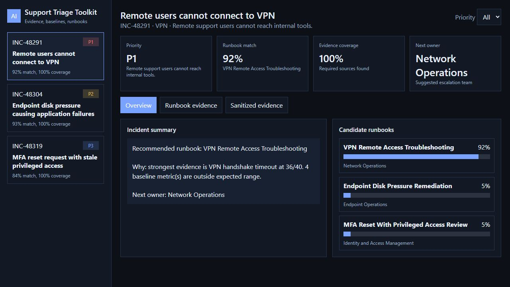
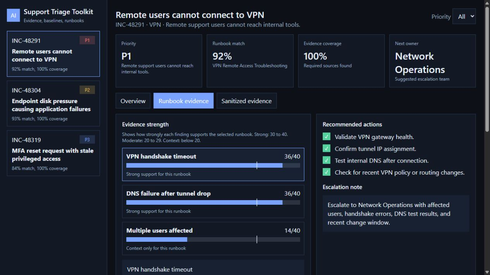
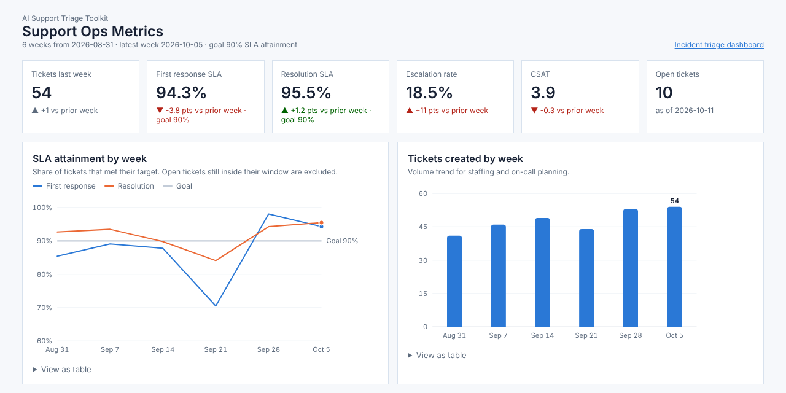

# AI Support Triage Toolkit

AI Support Triage Toolkit is a local-first support engineering project that turns tickets, logs, and endpoint or identity evidence into sanitized summaries, baseline outlier checks, runbook recommendations, and an interactive dashboard.

It also includes a support operations view for team leads: SLA attainment, weekly trends, systemic issue detection, a ticket quality review rubric, and a coaching view, all generated from ticket data.

The goal is to show practical enterprise support skills:

- Evidence-based incident triage
- Baseline metric comparison for endpoint, network, and IAM issues
- Runbook recommendation logic
- Sanitization before sharing logs or using AI workflows
- Clear escalation notes for support, infrastructure, endpoint, and IAM teams
- Support team metrics, SLA tracking, and quality review that drive process improvements

## Development approach

This toolkit was developed with assistance from Claude and Codex. Claude-authored commits introduced substantial parts of the support operations metrics module, dashboard, sample data, documentation, and tests. Commit attribution is retained.

The incident triage engine uses explicit rules and weighted scoring. Its match score is not a calibrated probability or measured accuracy. The fictional ticket data and generated reports demonstrate workflow behavior, not production results. Future case studies will distinguish owner decisions and review findings from AI implementation assistance and automated checks.

On October 22, 2026, the owner applied a guided fix for missing SLA outcomes being treated as zero attainment, added AI-supplied regression tests, and personally ran the support-operations tests. See the [SLA coaching fix and verification](docs/sla-coaching-fix.md) for the behavior, evidence, and division of work.

## What This Solves

Support teams often receive messy ticket notes, screenshots, log snippets, endpoint health data, and identity exports. This project simulates a safer workflow:

1. Load incident evidence from JSON.
2. Mask sensitive values such as emails, private IPs, hostnames, user IDs, and session IDs.
3. Compare observed metrics against enterprise-style baselines.
4. Score which runbook best matches the evidence.
5. Generate a triage result, escalation note, and dashboard data.

## Quick Start

```powershell
python -m app.triage --input data/sample_incidents.json --runbooks runbooks --output output/triage-results.json --summary output/support-summary.md
python -m app.support_ops
python -m unittest discover -s tests
python -m http.server 8000
```

Then open:

```text
http://localhost:8000/dashboard/                  incident triage
http://localhost:8000/dashboard/support-ops.html  support ops metrics
```

The triage dashboard includes sample results for quick review. After you run the triage command, it loads the generated `output/triage-results.json` file. The support ops dashboard loads `output/support-ops-metrics.json` after `python -m app.support_ops` runs, and falls back to the committed example in `examples/` otherwise.

On Windows, you can also run:

```powershell
.\scripts\run_demo.ps1
```

## Live Dashboards

Both dashboards are published with GitHub Pages from the `/docs` folder on `main`:

- Incident triage: https://emckrieth.github.io/ai-support-triage-toolkit/
- Support ops metrics: https://emckrieth.github.io/ai-support-triage-toolkit/support-ops.html

The published pages use the committed sample data. `docs/index.html` and `docs/support-ops.html` are copies of the files in `dashboard/`, and `docs/support-ops-metrics.json` is a copy of `examples/support-ops-metrics.json`. Copy them again after changing a dashboard or regenerating the example.

## Two-Minute Demo

1. Run `.\scripts\run_demo.ps1`.
2. Start the local web server with `python -m http.server 8000`.
3. Open `http://localhost:8000/dashboard/`.
4. Select each incident in the left panel and review the recommended runbook, baseline outliers, evidence coverage, and escalation notes.
5. Open `output/support-summary.md` to see the support-ready summary generated from the same data.
6. Open `http://localhost:8000/dashboard/support-ops.html` for the team lead view, and `output/weekly-support-review.md` for the weekly review write-up.

## Dashboard Preview

The dashboard is designed for quick operational review. It shows:

- incident priority and next owner
- runbook confidence score
- baseline metric comparisons
- evidence sources used for the recommendation
- sanitized ticket notes and escalation details

This helps a support engineer explain why a runbook was selected instead of only showing a final recommendation.





## Support Ops Metrics (Team Lead View)

The triage engine works one incident at a time. The support ops module looks at the whole queue, the way a support lead runs a weekly review.

```powershell
python -m app.support_ops
python -m http.server 8000
```

Then open `http://localhost:8000/dashboard/support-ops.html`, or view the [live version](https://emckrieth.github.io/ai-support-triage-toolkit/support-ops.html).



From six weeks of fictional tickets (`data/support_tickets.csv`) and QA reviews (`data/qa_reviews.csv`) it produces:

- **SLA attainment** by week and priority, using the targets in `data/sla_policy.json`. Open tickets still inside their window count as pending, not missed.
- **Volume and escalation trends** by week and category.
- **Systemic issues**: volume spikes, high escalation rates, and high reopen rates that should go to Engineering or Product, each with a next step.
- **Quality review scores** from a weighted rubric (`data/qa_rubric.json`) with auto-fail rules for things like pasting a customer API key.
- **SLA by customer tier**, including first response on urgent (P1/P2) tickets, the number enterprise customers judge support on.
- **Coaching focus per engineer** for 1:1s, built from QA weak spots and SLA results.
- **A weekly review write-up** in Markdown, ready to share with Engineering, Product, and Customer Success. See `examples/weekly-support-review.md`.

The sample data has a story to find: a webhook delivery spike after a fictional release, risk score questions that escalate too often, an on-call gap week where P1 and P2 response times slipped, and enterprise customers waiting longest on urgent tickets.

### Reading the dashboard as a support lead

What I would tell the team, Engineering, and Customer Success from the week of 2026-10-05:

1. **Webhook delivery is a product problem, not a support problem.** Tickets ran at 2.6x the usual weekly volume and reopen 16% of the time. I'd open a problem record and ask Engineering for a fix owner and date, and have one engineer write the KB article so the next ticket is a five-minute answer.
2. **Enterprise customers are waiting too long on urgent tickets.** Only 80% of enterprise P1 and P2 tickets got a first response on time, against a 90% goal. Enterprise also has the highest escalation rate (16.5%) and the lowest CSAT (3.73). I'd review on-call coverage and routing for urgent enterprise tickets with Customer Success before it becomes a renewal conversation.
3. **Escalations jumped 11 points to 18.5%, led by risk score questions** (28.1% escalated). Support needs either a runbook for explaining scores or read access to decision logs. I'd ask Engineering which one they can deliver first.

On the team side, the lowest QA dimension is communication, which becomes this month's training topic. The pasted API key is handled privately in a 1:1, together with a request for secret scanning on ticket replies.

Supporting docs:

- `docs/support-ops-metrics.md` - metric definitions and systemic issue rules
- `docs/severity-and-on-call.md` - priority and severity levels, on-call duties, handoffs, escalation paths
- `docs/qa-review-framework.md` - rubric, auto-fail rules, calibration, and how results are used

## Example Scenarios

The sample data includes three support scenarios:

- Remote users cannot connect to VPN
- Endpoint disk pressure causing application failures
- MFA reset request with stale privileged access

Each scenario includes ticket notes, technical evidence, observed metrics, and expected ownership.

## How Runbook Matching Works

Each runbook defines:

- Evidence signals and keywords
- Baseline metrics and thresholds
- Required evidence sources
- Recommended actions
- Escalation owner

The tool does not pretend to replace an engineer. It organizes evidence so an engineer can make a faster and safer decision.

For more detail, see `docs/decision-model.md`.

## Baseline Metrics

The baseline checks use practical operating thresholds that are common in large support environments. They are not universal company policy. They are examples a support engineer can tune for their own environment.

Examples:

- Free disk below 15 percent is actionable
- Packet loss above 1 percent is abnormal
- Internal DNS lookup time above 300 ms is suspicious
- Privileged access review older than 90 days needs IAM review
- Verification evidence older than 24 hours should be refreshed

## Project Structure

```text
ai-support-triage-toolkit/
├── app/
│   ├── __init__.py
│   ├── support_ops.py
│   └── triage.py
├── dashboard/
│   ├── index.html
│   └── support-ops.html
├── data/
│   ├── qa_reviews.csv
│   ├── qa_rubric.json
│   ├── sample_incidents.json
│   ├── sla_policy.json
│   └── support_tickets.csv
├── docs/
│   ├── assets/
│   │   ├── dashboard-overview.png
│   │   ├── runbook-evidence.png
│   │   └── support-ops-dashboard.png
│   ├── architecture.md
│   ├── decision-model.md
│   ├── index.html
│   ├── metrics-baselines.md
│   ├── qa-review-framework.md
│   ├── runbook-authoring.md
│   ├── severity-and-on-call.md
│   ├── support-ops-metrics.json
│   ├── support-ops-metrics.md
│   └── support-ops.html
├── examples/
│   ├── sample-output.md
│   ├── support-ops-metrics.json
│   └── weekly-support-review.md
├── runbooks/
│   ├── endpoint-disk-pressure.json
│   ├── iam-mfa-privileged-review.json
│   └── vpn-remote-access.json
├── scripts/
│   ├── generate_support_data.py
│   └── run_demo.ps1
├── tests/
│   ├── test_support_ops.py
│   └── test_triage.py
├── .gitignore
├── LICENSE
└── pyproject.toml
```

## Why This Is Relevant

This repo demonstrates skills that map to systems, support, and IAM engineering roles:

- Troubleshooting from evidence instead of guessing
- Knowing when a metric is an outlier
- Writing reusable operational runbooks
- Protecting sensitive data before sharing
- Creating clear escalation notes
- Building useful automation around real support workflows
- Running a support team on data: SLAs, trends, systemic issues, and quality review
- Turning ticket patterns into specific asks for Engineering and Product

## Safety Note

All sample data is fictional and sanitized. Do not commit real production logs, customer data, private IP ranges from a real employer, tokens, secrets, or internal hostnames.
